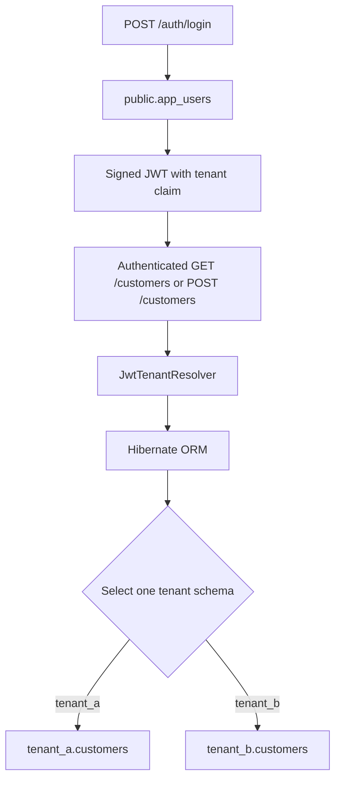

# Quarkus Schema-per-Tenant

[English](README.md) | [Português](README.pt-BR.md)

A small REST API demonstrating schema-per-tenant multitenancy with Quarkus, Hibernate ORM, PostgreSQL, Flyway and JWT. Shared users live in `public.app_users`; customer data lives in `tenant_a.customers` and `tenant_b.customers`.

## How it works

1. Anonymous `POST /auth/login` requests resolve to `public`, allowing login to query the shared `public.app_users` table and check the demo password.
2. The API signs a JWT containing the user ID, email, `user` role and `tenant` claim.
3. `GET /customers` and `POST /customers` require a JWT with the `user` role.
4. `JwtTenantResolver` reads the tenant claim and checks an explicit schema allowlist. Hibernate uses the resolved tenant in its persistence context to access the corresponding customer table.

In this demo, `public` stores users only. The two demo users access customers in `tenant_a` and `tenant_b` respectively.

## Why schema-per-tenant?

In a shared-schema implementation, tenants commonly share a table with a discriminator such as `tenant_id`:

```sql
SELECT *
FROM customers
WHERE tenant_id = :tenantId;
```

The tenant boundary must be preserved across data access paths. An important question is: **“Is this query filtering the correct tenant?”**

With schema-per-tenant, the question becomes: **“Is this operation running in the correct tenant context?”** The tenant is resolved in the persistence context, so this project's customer repository can use tenant-agnostic JPQL:

```jpql
SELECT c FROM Customer c ORDER BY c.id
```

The repository does not need a `tenant_id` column or a tenant predicate. Hibernate routes the operation to `tenant_a.customers` or `tenant_b.customers` using the resolved schema.

This changes the nature of the isolation risk; it does not eliminate isolation bugs. Shared schema risks missing or incorrectly applying the tenant discriminator. Schema-per-tenant risks resolving or propagating the wrong tenant context.

## Shared schema vs. schema-per-tenant

Both approaches can use one database and keep shared data in a common schema. This project implements only the schema-per-tenant approach.

| Aspect | Shared / single schema | Schema-per-tenant |
| --- | --- | --- |
| Storage | Tenants share tables, typically with `tenant_id`. | Each tenant has tables in its own schema. |
| Isolation boundary | Rows scoped through tenant predicates or database policies. | Database namespace and persistence context. |
| Tenant filtering | Enforced along data access paths, by application logic or database policies. | Queries can be tenant-agnostic; the tenant context must be correct. |
| Migrations | A table change generally applies once to shared tables. | Changes must be applied consistently to each tenant schema. |
| Provisioning | A new tenant usually does not need new tables. | A new tenant needs a schema and its database objects. |
| Database objects | Fewer schemas, tables and indexes as tenant count grows. | Schemas, tables and indexes multiply with tenant count. |
| Cross-tenant queries | Shared tables make combined queries easier. | Queries must explicitly access multiple schemas. |
| Tenant-specific operations | Must target the correct tenant's rows. | Separate namespaces help target a tenant's tables; coordination is still required. |

## Architecture and request flow



The selected schema determines which customer table is accessed; a request does not query both tables.

**Schema-per-tenant does not provide physical database isolation.** All schemas in this project use the same PostgreSQL instance and the same datasource credentials and connection pool. CPU, memory, I/O and infrastructure remain shared. The demonstrated isolation is structural and logical, through PostgreSQL namespaces and the persistence context.

Schema-per-tenant does not automatically make an application secure. It moves an important part of tenant isolation from repeated query predicates to the database namespace and persistence context.

## What about PostgreSQL Row Level Security?

PostgreSQL Row Level Security (RLS) applies row access restrictions directly in PostgreSQL and is a relevant alternative for shared-schema architectures. Its effectiveness depends on correctly configured policies, session context and permissions.

This project does not implement RLS: it demonstrates isolation through separate schemas and tenant context.

## When to choose each approach

Choose **shared schema** when tenants share a data model and simpler migrations, provisioning and database administration are priorities. It can also make cross-tenant reporting easier. Tenant boundaries must remain enforced for every data access path.

Choose **schema-per-tenant** when separate tables and namespaces help organize tenant data and perform tenant-specific operations, and the cost of managing those objects is acceptable.

Neither approach is universally better. Schema-per-tenant adds provisioning and migration coordination, makes cross-tenant operations more involved and increases the number of schemas, tables and indexes to administer. That cost can become significant with a very large tenant count.

Asynchronous tasks and scheduled jobs must explicitly establish the correct tenant context: they cannot assume an authenticated HTTP request context will be available. These flows are not implemented in this demo.

## Project structure

```text
src/main/java/dev/erick/multitenancy/
├── dto/          # Request and response records
├── model/        # JPA entities
├── repository/   # Database access
├── resource/     # REST endpoints
├── service/      # Application logic
└── tenancy/      # JWT tenant resolution
src/main/resources/db/migration/       # Flyway SQL
src/test/java/dev/erick/multitenancy/   # Unit and integration tests
```

## Requirements

- JDK 25 (the release configured in `pom.xml`).
- Maven 3.9.x installed.
- Docker Compose or Podman Compose for the provided PostgreSQL 17 container.
- OpenSSL to generate a local RSA key pair.

## Run locally

Start the database:

```bash
docker compose up -d
```

Or use Podman Compose:

```bash
podman compose up -d
```

The private signing key is intentionally ignored by Git. Generate a **matching pair** for local development; the public key command replaces the supplied public key:

```bash
openssl genpkey -algorithm RSA -pkeyopt rsa_keygen_bits:2048 -out src/main/resources/privateKey.pem
openssl pkey -in src/main/resources/privateKey.pem -pubout -out src/main/resources/publicKey.pem
mvn quarkus:dev
```

The API runs at `http://localhost:8080`. Flyway creates and seeds the schemas on startup. Dev UI: `http://localhost:8080/q/dev/`.

Default database settings can be overridden with environment variables:

| Variable | Default |
| --- | --- |
| `DB_URL` | `jdbc:postgresql://localhost:5432/multitenant` |
| `DB_USERNAME` | `quarkus` |
| `DB_PASSWORD` | `quarkus` |

## Try the API

Both demo users use password `password`:

| Email | Schema |
| --- | --- |
| `johndoe@demo.local` | `tenant_a` |
| `janedoe@demo.local` | `tenant_b` |

```bash
curl -X POST http://localhost:8080/auth/login \
  -H 'Content-Type: application/json' \
  -d '{"email":"johndoe@demo.local","password":"password"}'
```

Copy `accessToken` from the response into `TOKEN`:

```bash
TOKEN='paste-accessToken-here'
curl http://localhost:8080/customers -H "Authorization: Bearer $TOKEN"
curl -i -X POST http://localhost:8080/customers \
  -H "Authorization: Bearer $TOKEN" \
  -H 'Content-Type: application/json' \
  -d '{"name":"New customer"}'
```

Repeat login with the other user to access the other schema's customers. Tokens expire after 3,600 seconds by default.

| Endpoint | Behavior |
| --- | --- |
| `POST /auth/login` | Public; returns `accessToken` and `tenant`; invalid credentials produce 401. |
| `GET /customers` | Requires role `user`; returns customers ordered by ID. |
| `POST /customers` | Requires role `user`; returns 201 with the customer and `Location` header. |

## Tests and packaging

### Unit tests

```bash
mvn test
```

JUnit/Mockito tests check login success and rejection, JWT claim construction with mocked signing, tenant resolution, customer service behavior and resource return values. They run without PostgreSQL or a running Quarkus instance.

### Integration tests

```bash
mvn verify
```

This command runs both the unit tests (Surefire) and the integration tests (Failsafe). `TenantIsolationIT` uses `@QuarkusTest`, REST Assured, real JWT signing and validation, Flyway migrations and Hibernate ORM against PostgreSQL 17. No tenant resolver, persistence component or datasource is mocked.

The suite verifies both demo logins, isolated Acme/Globex reads, a uniquely named customer created by John that Jane cannot see, and HTTP 401 for unauthenticated customer reads. It exercises the real flow:

```text
HTTP → JWT → SecurityIdentity → JwtTenantResolver → Hibernate ORM → PostgreSQL schema
```

Locally, Testcontainers starts a disposable `postgres:17-alpine` container. A Docker-compatible container runtime must be available; Podman requires its Docker-compatible socket to be configured for Testcontainers. You do not need to start Compose, supply a token or generate keys manually: the test resource creates a temporary RSA pair and removes it afterward.

In CI, `.github/workflows/ci.yml` runs `mvn -B -ntp verify` with Temurin 25 and a healthy PostgreSQL 17 service. The workflow creates a matching RSA pair in the runner's temporary directory without printing the keys. Test-only `TEST_DATABASE_URL`, `TEST_DATABASE_USERNAME`, `TEST_DATABASE_PASSWORD`, `TEST_JWT_PRIVATE_KEY` and `TEST_JWT_PUBLIC_KEY` variables connect the suite to that disposable service and those keys. Production settings and keys are unchanged.

### Packaging

```bash
mvn package
java -jar target/quarkus-app/quarkus-run.jar
```

`mvn package` runs unit tests and packages the application; `mvn verify` additionally runs the integration suite. Running the packaged application requires the database and keys described under “Run locally”.

## Out of scope

Production-grade authentication, password hashing, refresh tokens, rate limiting, automatic tenant provisioning and PostgreSQL RLS are intentionally outside this demo's scope. The fixed demo password keeps the example focused on tenant resolution and schema isolation. Listing and creating customers are enough to illustrate that flow.
