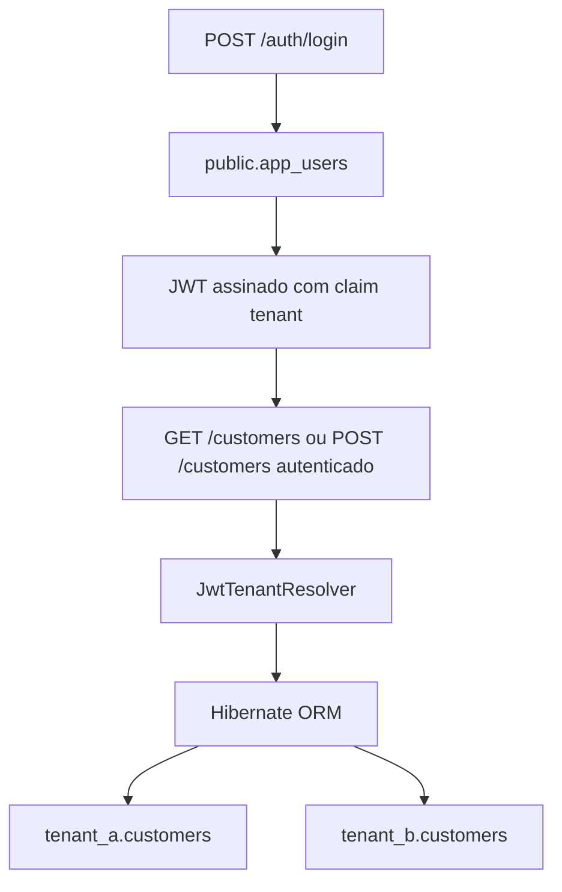

# Quarkus Schema-per-Tenant

[English](README.md) | [Português](README.pt-BR.md)

Uma pequena API REST que demonstra multitenancy com schema-per-tenant usando Quarkus, Hibernate ORM, PostgreSQL, Flyway e JWT. Os usuários compartilhados ficam em `public.app_users`; os clientes ficam em `tenant_a.customers` e `tenant_b.customers`.

## Como funciona

1. Requisições anônimas a `POST /auth/login` resolvem para `public`, permitindo consultar a tabela compartilhada `public.app_users` e verificar a senha de demonstração.
2. A API assina um JWT com ID do usuário, e-mail, papel `user` e claim `tenant`.
3. `GET /customers` e `POST /customers` exigem JWT com papel `user`.
4. `JwtTenantResolver` lê a claim de tenant e verifica uma lista explícita de schemas permitidos. O Hibernate usa o tenant resolvido no contexto de persistência para acessar a tabela de clientes correspondente.

Nesta demo, `public` armazena apenas os usuários. Os dois usuários de exemplo acessam os clientes de `tenant_a` e `tenant_b`, respectivamente.

## Por que schema-per-tenant?

Em uma implementação com shared schema, os tenants normalmente compartilham uma tabela com um discriminador como `tenant_id`:

```sql
SELECT *
FROM customers
WHERE tenant_id = :tenantId;
```

A fronteira do tenant precisa ser preservada nos caminhos de acesso aos dados. Uma pergunta importante é: **“Esta consulta está filtrando o tenant correto?”**

Com schema-per-tenant, a pergunta passa a ser: **“Esta operação está executando no contexto do tenant correto?”** O tenant é resolvido no contexto de persistência, permitindo que o repositório de clientes deste projeto use JPQL sem referência ao tenant:

```jpql
SELECT c FROM Customer c ORDER BY c.id
```

O repositório não precisa de coluna `tenant_id` nem de um filtro de tenant. O Hibernate direciona a operação para `tenant_a.customers` ou `tenant_b.customers` conforme o schema resolvido.

Isso muda a natureza do risco de isolamento; não elimina bugs de isolamento. Em shared schema, existe o risco de omitir ou aplicar incorretamente o discriminador de tenant. Em schema-per-tenant, o risco está em resolver ou propagar o contexto de tenant incorreto.

## Shared schema versus schema-per-tenant

As duas abordagens podem usar um único banco e manter dados compartilhados em um schema comum. Este projeto implementa apenas a abordagem schema-per-tenant.

| Aspecto | Shared / single schema | Schema-per-tenant |
| --- | --- | --- |
| Armazenamento | Os tenants compartilham tabelas, normalmente com `tenant_id`. | Cada tenant possui tabelas em seu próprio schema. |
| Fronteira de isolamento | Linhas delimitadas por filtros de tenant ou políticas do banco. | Namespace do banco e contexto de persistência. |
| Filtro de tenant | Aplicado nos caminhos de acesso aos dados, pela aplicação ou por políticas do banco. | As consultas podem ignorar o tenant; o contexto de tenant precisa estar correto. |
| Migrações | Uma alteração de tabela geralmente é aplicada uma vez às tabelas compartilhadas. | Alterações precisam ser aplicadas de forma consistente a cada schema de tenant. |
| Provisionamento | Um novo tenant normalmente não exige novas tabelas. | Um novo tenant exige um schema e seus objetos no banco. |
| Objetos no banco | Menos schemas, tabelas e índices conforme aumenta o número de tenants. | Schemas, tabelas e índices se multiplicam com o número de tenants. |
| Consultas entre tenants | Tabelas compartilhadas facilitam consultas combinadas. | As consultas precisam acessar explicitamente múltiplos schemas. |
| Operações específicas de um tenant | Precisam delimitar as linhas do tenant correto. | Namespaces separados ajudam a direcionar operações às tabelas de um tenant; ainda é preciso coordená-las. |

## Arquitetura e fluxo de requisições



O schema selecionado determina qual tabela de clientes será acessada; uma requisição não consulta as duas tabelas.

**Schema-per-tenant não oferece isolamento físico de banco de dados.** Todos os schemas deste projeto usam a mesma instância PostgreSQL e as mesmas credenciais e pool de conexões do datasource. CPU, memória, I/O e infraestrutura continuam compartilhados. O isolamento demonstrado é estrutural e lógico, por meio dos namespaces PostgreSQL e do contexto de persistência.

Schema-per-tenant não torna uma aplicação automaticamente segura. Ele transfere uma parte importante do isolamento de tenants dos filtros repetidos nas consultas para o namespace do banco e o contexto de persistência.

## E o PostgreSQL Row Level Security?

O PostgreSQL Row Level Security (RLS) aplica restrições de acesso às linhas diretamente no PostgreSQL e é uma alternativa relevante para arquiteturas shared schema. Sua eficácia depende de políticas, contexto de sessão e permissões corretamente configurados.

Este projeto não implementa RLS: ele demonstra isolamento por schemas separados e contexto de tenant.

## Quando escolher cada abordagem

Escolha **shared schema** quando os tenants compartilham o modelo de dados e a prioridade é simplificar migrações, provisionamento e administração do banco. Essa abordagem também pode facilitar relatórios entre tenants. As fronteiras de tenant precisam ser preservadas em todos os caminhos de acesso aos dados.

Escolha **schema-per-tenant** quando tabelas e namespaces separados ajudam a organizar os dados e a executar operações específicas de cada tenant, e o custo de administrar esses objetos é aceitável.

Nenhuma abordagem é sempre melhor. Schema-per-tenant exige coordenação adicional de provisionamento e migrações, torna operações entre tenants mais trabalhosas e aumenta a quantidade de schemas, tabelas e índices para administrar. Esse custo pode se tornar significativo com um número muito grande de tenants.

Tarefas assíncronas e jobs agendados precisam estabelecer explicitamente o contexto de tenant correto: não podem presumir que haverá um contexto de requisição HTTP autenticada disponível. Esses fluxos não estão implementados nesta demo.

## Estrutura do projeto

```text
src/main/java/dev/erick/multitenancy/
├── dto/          # Records de requisição e resposta
├── model/        # Entidades JPA
├── repository/   # Acesso ao banco
├── resource/     # Endpoints REST
├── service/      # Lógica da aplicação
└── tenancy/      # Resolução de tenant pelo JWT
src/main/resources/db/migration/       # SQL do Flyway
src/test/java/dev/erick/multitenancy/   # Testes unitários
```

## Pré-requisitos

- JDK 25 (versão configurada no `pom.xml`).
- Maven 3.9.x instalado.
- Docker Compose ou Podman Compose para o container PostgreSQL 17 fornecido.
- OpenSSL para gerar um par de chaves RSA local.

## Executar localmente

Inicie o banco:

```bash
docker compose up -d
```

Ou use Podman Compose:

```bash
podman compose up -d
```

A chave privada de assinatura é ignorada pelo Git. Gere um **par correspondente** para desenvolvimento local; o comando da chave pública substitui a chave pública fornecida:

```bash
openssl genpkey -algorithm RSA -pkeyopt rsa_keygen_bits:2048 -out src/main/resources/privateKey.pem
openssl pkey -in src/main/resources/privateKey.pem -pubout -out src/main/resources/publicKey.pem
mvn quarkus:dev
```

A API fica em `http://localhost:8080`. O Flyway cria e popula os schemas na inicialização. Dev UI: `http://localhost:8080/q/dev/`.

As configurações padrão do banco podem ser substituídas por variáveis de ambiente:

| Variável | Padrão |
| --- | --- |
| `DB_URL` | `jdbc:postgresql://localhost:5432/multitenant` |
| `DB_USERNAME` | `quarkus` |
| `DB_PASSWORD` | `quarkus` |

## Experimentar a API

Os dois usuários de demonstração usam a senha `password`:

| E-mail | Schema |
| --- | --- |
| `johndoe@demo.local` | `tenant_a` |
| `janedoe@demo.local` | `tenant_b` |

```bash
curl -X POST http://localhost:8080/auth/login \
  -H 'Content-Type: application/json' \
  -d '{"email":"johndoe@demo.local","password":"password"}'
```

Copie o valor de `accessToken` da resposta para `TOKEN`:

```bash
TOKEN='cole-o-accessToken-aqui'
curl http://localhost:8080/customers -H "Authorization: Bearer $TOKEN"
curl -i -X POST http://localhost:8080/customers \
  -H "Authorization: Bearer $TOKEN" \
  -H 'Content-Type: application/json' \
  -d '{"name":"Novo cliente"}'
```

Repita o login com o outro usuário para acessar os clientes do outro schema. Os tokens expiram após 3.600 segundos por padrão.

| Endpoint | Comportamento |
| --- | --- |
| `POST /auth/login` | Público; retorna `accessToken` e `tenant`; credenciais inválidas retornam 401. |
| `GET /customers` | Exige papel `user`; retorna clientes ordenados por ID. |
| `POST /customers` | Exige papel `user`; retorna 201 com o cliente e o cabeçalho `Location`. |

## Testes e empacotamento

```bash
mvn test
mvn package
java -jar target/quarkus-app/quarkus-run.jar
```

Os testes unitários com JUnit/Mockito verificam sucesso e rejeição do login, construção das claims JWT com assinatura simulada, resolução de tenant, comportamento do serviço de clientes e retornos dos recursos, incluindo conversão para DTO e respostas de criação. Eles executam sem PostgreSQL ou uma instância do Quarkus em execução.

Esses testes não verificam o isolamento real entre schemas PostgreSQL, a execução do Flyway ou o fluxo completo de multitenancy do Hibernate. Esses comportamentos exigiriam testes de integração.

## Fora do escopo

Autenticação para produção, hash de senhas, refresh tokens, rate limiting, provisionamento automático de tenants e PostgreSQL RLS ficam intencionalmente fora do escopo desta demo. A senha fixa de demonstração mantém o exemplo focado na resolução de tenant e no isolamento por schema. Listar e criar clientes é suficiente para ilustrar esse fluxo.
